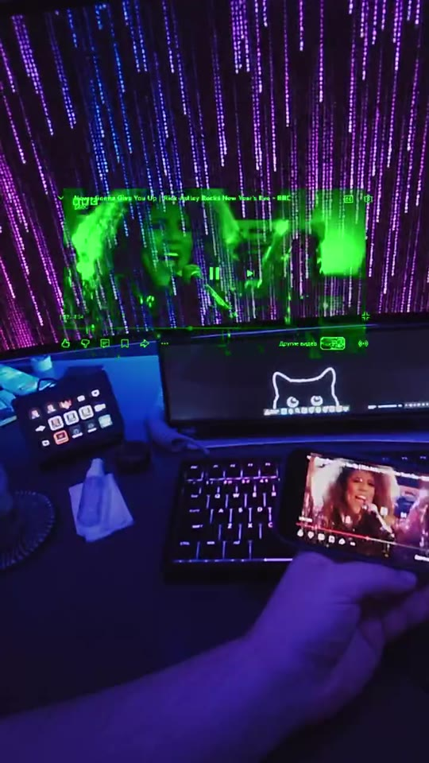

# Display Bridge

Display Bridge turns Rokid Glasses into a low-latency, video-only Android display over USB or an optional local Wi-Fi Direct link. It consists of a phone companion and a separate glasses receiver connected through Android Open Accessory (AOA) or encrypted authenticated TCP and the bounded DBP1 protocol.

> **Independent project:** Display Bridge is not affiliated with, endorsed by, or an official product of Rokid Corporation. Rokid and related product names are trademarks of their respective owners.

> **MVP status:** `v0.3.2` is the current release-signed build and fixes Wi-Fi Direct coexistence with Hi Rokid and other applications. The core External Display and Screen Mirror paths work on the target Pixel/RG_glasses pair, while several long-run and physical-input acceptance checks remain documented as pending.

## Video demo

[](https://github.com/azhilin246/RokidDisplayBridge/releases/download/v0.3.2/rokid-display-bridge-demo.mp4)

[▶ Watch the four-minute demo](https://github.com/azhilin246/RokidDisplayBridge/releases/download/v0.3.2/rokid-display-bridge-demo.mp4) — External Display, Screen Mirror, wireless connection, and layout controls. The demo has no audio track.

## Features

- **External Display** publishes a 480×640 public presentation `VirtualDisplay`. Any Android application that supports presentation displays can render to it.
- **Screen Mirror** captures the whole phone display after fresh Android MediaProjection consent.
- **Video only:** hardware AVC encoding/decoding; audio remains on the phone and follows normal Android/Bluetooth routing.
- **Low-latency transport:** bounded queues, latest-frame pressure handling, fragmentation/reassembly, keyframe feedback, session/generation filtering, and idempotent cleanup.
- **Wireless mode:** local Wi-Fi Direct, encrypted authenticated TCP, and explicit one-time trust-on-first-use pairing without a router, code, gestures, or USB pairing.
- **Glasses controls:** configurable tap and one-action-per-gesture swipes; double tap is reserved for immediate exit, and media keys are routed back to Android.
- **Layout:** fixed 3:4 resizing and placement, live preview, named favorites, precise scale/X/Y entry, and drag-and-drop ordering.
- **Diagnostics:** connection, AOA identity, handshake, encoder, thermal state, FPS, bitrate, sent/dropped frames, and queue depth.

## Packages

| Target | Application ID | Role |
|---|---|---|
| Android phone | `com.azhilin.rokid.displaybridge.companion` | AOA host, display source, AVC encoder |
| Rokid Glasses | `com.azhilin.rokid.displaybridge.glasses` | AOA accessory, AVC decoder, 480×640 presentation |

## Project layout

```text
apps/android-companion/  Phone application
apps/glasses/            Glasses application
protocol/kotlin/         Shared bounded DBP1 protocol
protocol/specification/  Wire protocol reference
openspec/                Product specifications and tracked acceptance work
docs/                    Architecture, verification, and release notes
```

See [architecture](docs/architecture.md) and the [verification record](docs/verification.md) for implementation and acceptance details.

## Requirements

- Android Studio JBR or another Java 21+ runtime (required by Robolectric for SDK 36 tests)
- Android SDK 36
- A phone with USB host support (tested on Pixel 10)
- Rokid Glasses with a 480×640 display
- Wi-Fi Direct support on both devices for optional wireless mode

## Build and verify

On Windows:

```powershell
.\gradlew.bat :protocol:kotlin:testDebugUnitTest `
  :apps:android-companion:testDebugUnitTest `
  :apps:glasses:testDebugUnitTest `
  :apps:android-companion:lintDebug `
  :apps:glasses:lintDebug `
  :apps:android-companion:assembleDebug `
  :apps:glasses:assembleDebug `
  --no-configuration-cache
```

Generated debug APKs:

- `apps/android-companion/build/outputs/apk/debug/android-companion-debug.apk`
- `apps/glasses/build/outputs/apk/debug/glasses-debug.apk`

## Install

Always select exact device serials. The phone APK should be scoped to the owner profile:

```powershell
adb devices -l
adb -s <phone-serial> shell pm list users
adb -s <phone-serial> install --user 0 -r "apps/android-companion/build/outputs/apk/release/android-companion-release.apk"
adb -s <glasses-serial> install -r "apps/glasses/build/outputs/apk/release/glasses-release.apk"
```

## Usage

### USB

1. Install both APKs and open Display Bridge on the phone.
2. Connect the glasses to the phone by USB and approve Android's USB requests when shown.
3. Select External Display or Screen Mirror at any time. Display Bridge remembers the choice and applies it after each Wired or Wireless connection.
4. Screen Mirror opens Android's capture-permission prompt when a new grant is required.
5. Open Layout and Gestures from the companion menu when needed.

### Wireless

1. Enable Wi-Fi/Nearby access on both devices and manually open Display Bridge on the glasses.
2. On the phone select **Pair new glasses**. On unpaired glasses, single tap starts wireless pairing.
3. The explicit first connection performs a fresh ECDH handshake automatically and stores exactly one peer after mutual key confirmation. No gesture or code entry is required. Double tap still exits Display Bridge and cancels an in-progress connection.
4. DBP1 then runs in bounded AES-256-GCM records with fresh directional keys. Later application launches mutually authenticate the stored peer and derive new traffic keys automatically.
5. Use **Forget paired glasses** before pairing a replacement device.
6. After authentication, the saved Output mode starts automatically; Screen Mirror requests Android capture permission when needed.

Wireless mode requires no router, Internet route, account, cloud service, QR code, typed PIN, or USB pairing. If another application owns the Wi-Fi Direct group, release that group and retry.

Protected or DRM content may appear black during Screen Mirror. The bridge does not capture audio, change audio routes, bypass protected surfaces, or emulate Chromecast/Miracast/HDMI.

## Release signing

Stable GitHub assets are signed with the dedicated Display Bridge release certificate. Its public certificate is committed as [`docs/display-bridge-release-certificate.pem`](docs/display-bridge-release-certificate.pem); the certificate SHA-256 is `2C:AA:FA:50:01:48:27:FB:3B:A8:4C:E7:A4:0A:F4:2B:F7:5B:33:22:D8:B6:9E:97:BE:B1:29:49:F2:E5:F5:EC`. Private signing material is never stored in Git.

For a local signed build, create an ignored `keystore.properties` file:

```properties
storeFile=C:/absolute/path/to/DisplayBridge-release.p12
storePassword=<secret>
keyAlias=<alias>
keyPassword=<secret>
```

Then build both release APKs:

```powershell
.\gradlew.bat :apps:android-companion:assembleRelease :apps:glasses:assembleRelease
```

Generated release APKs:

- `apps/android-companion/build/outputs/apk/release/android-companion-release.apk`
- `apps/glasses/build/outputs/apk/release/glasses-release.apk`

Back up the keystore and its credentials securely. Losing them makes future in-place Android updates impossible. A release-signed APK cannot update an already installed debug-signed build; uninstall only the corresponding Display Bridge debug package once before switching channels.

## Privacy

Display Bridge has no analytics, telemetry, account, cloud backend, or Internet client. Android requires the manifest permission named `INTERNET` for local Java TCP sockets; wireless video is bound to the peer Wi-Fi Direct link and is not uploaded. Video is hardware-encoded on the phone and sent only to the connected glasses over USB/AOA or AES-256-GCM protected local TCP. Audio is never captured or transported. Bridge settings, favorites, and Android-Keystore-encrypted single-peer wireless trust stay in local application storage.

Screen Mirror starts only after fresh Android system MediaProjection consent for that session. Protected or DRM content may appear black according to Android policy. Diagnostics can expose device and playback metadata on-screen or in local logs; sanitize logs before sharing them.

## Security

Report suspected vulnerabilities privately as described in [SECURITY.md](SECURITY.md). Never publish signing keys, passwords, USB serials, private media, or captured screen content in an issue.

## License

The source is available under the [PolyForm Noncommercial License 1.0.0](LICENSE). Noncommercial use, modification, distribution, and forks are permitted under its terms. Commercial use is reserved; contact the copyright holder for a separate commercial license.

This is a source-available license, not an OSI-approved open-source license. See [NOTICE](NOTICE) and [CONTRIBUTING.md](CONTRIBUTING.md).
